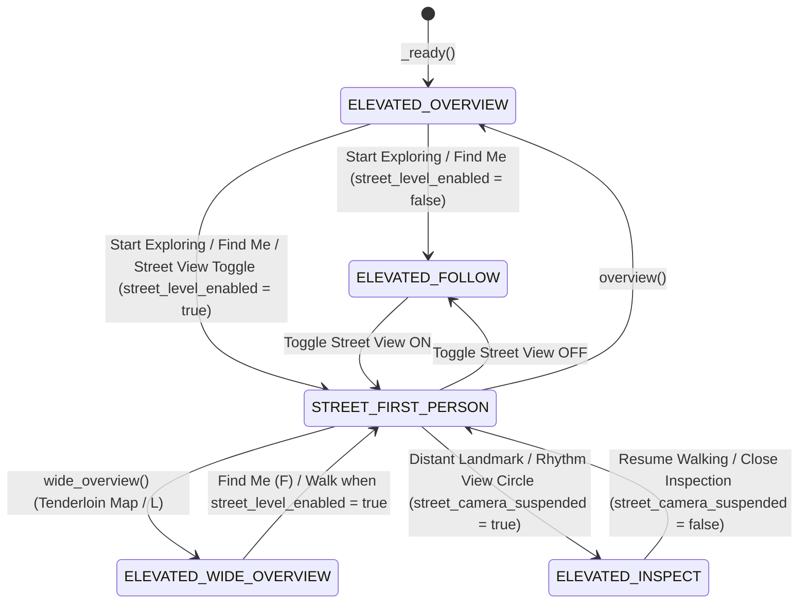

> **Unverified machine advice.** Gemini 4 Argon first-person plan, run read-only on November 1, 2026, at the creator's request, and saved unchanged below this header. Nothing here is a decision; the checked and merged plan is `docs/FIRST_PERSON_PLAN.md`, which lists the claims found false. Line numbers refer to commit `ce777e7`.

# First-Person (Street-Level) Transformation Plan for Tenderloin Redux (`godot/`)

---

## 1. Inventory of Current Systems and Elevated-Camera Assumptions

### 1.1 Camera Rig and Follow Logic
- **Camera Node & Projection**: A single [`camera`](file:///C:/tenderloin-redux/godot/main.gd#L436) (`Camera3D`) is instantiated in [`_ready()`](file:///C:/tenderloin-redux/godot/main.gd#L2058-L2062) with `camera.projection = Camera3D.PROJECTION_ORTHOGONAL`, added directly as a child of the root `Node3D` (`self`), marked `camera.current = true`, and positioned by [`update_camera()`](file:///C:/tenderloin-redux/godot/main.gd#L15098-L15129).
- **Rig State Variables**:
  - [`CAMERA_OFFSET`](file:///C:/tenderloin-redux/godot/main.gd#L20) `:= Vector3(180.0, 180.0, 180.0)` defines the default isometric offset vector from [`target`](file:///C:/tenderloin-redux/godot/main.gd#L466) (`Vector3(65, 0, -12)` initially).
  - [`view_size`](file:///C:/tenderloin-redux/godot/main.gd#L467) (`250.0` initially, clamped via [`clamp_view_size()`](file:///C:/tenderloin-redux/godot/main.gd#L15346-L15347) to `[24.0, maxf(900.0, overview_size * 2.5)]`) drives `camera.size` (`PROJECTION_ORTHOGONAL` frustum height in meters).
  - [`camera_yaw`](file:///C:/tenderloin-redux/godot/main.gd#L777) (`0.0`) and [`camera_pitch_scale`](file:///C:/tenderloin-redux/godot/main.gd#L778) (`1.0`, clamped to `[0.55, 1.65]` in [`rotate_camera_by_delta()`](file:///C:/tenderloin-redux/godot/main.gd#L14079-L14085)) rotate the offset vector around `Vector3.UP` via [`get_camera_offset_vec()`](file:///C:/tenderloin-redux/godot/main.gd#L14075-L14077).
  - Mode flags are scattered booleans: [`in_overview`](file:///C:/tenderloin-redux/godot/main.gd#L494) (`true`), [`in_wide_overview`](file:///C:/tenderloin-redux/godot/main.gd#L495) (`false`), and [`following_player`](file:///C:/tenderloin-redux/godot/main.gd#L523) (`false`).
- **Transform & Screen-Space Centering in [`update_camera()`](file:///C:/tenderloin-redux/godot/main.gd#L15098-L15129)**:
  - Sets `camera.size = view_size` ([`main.gd:15099`](file:///C:/tenderloin-redux/godot/main.gd#L15099)), computes `offset_scale := 2.2 if (in_wide_overview or view_size > 300.0) else 1.0` ([`main.gd:15100`](file:///C:/tenderloin-redux/godot/main.gd#L15100)), sets `camera.position = target + get_camera_offset_vec() * offset_scale` ([`main.gd:15101`](file:///C:/tenderloin-redux/godot/main.gd#L15101)), and calls `camera.look_at(target)` and `camera.force_update_transform()` ([`main.gd:15102-15103`](file:///C:/tenderloin-redux/godot/main.gd#L15102-L15103)).
  - When `following_player` is `true` and a side dock or compact narrow layout is active ([`main.gd:15106`](file:///C:/tenderloin-redux/godot/main.gd#L15106)), `update_camera()` computes orthographic pixels-per-meter `ppm := (camera.unproject_position(target + camera.global_basis.y) - camera.unproject_position(target)).length()` ([`main.gd:15108`](file:///C:/tenderloin-redux/godot/main.gd#L15108)) and shifts `target` along `camera.global_basis.x` and `camera.global_basis.y` so `player.position + Vector3.UP` and [`player_overlay_rect()`](file:///C:/tenderloin-redux/godot/main.gd#L7103-L7119) stay centered inside [`play_area_rect()`](file:///C:/tenderloin-redux/godot/main.gd#L7083-L7101) ([`main.gd:15110-15128`](file:///C:/tenderloin-redux/godot/main.gd#L15110-L15128)).
- **Follow Entry Points**:
  - [`follow_player()`](file:///C:/tenderloin-redux/godot/main.gd#L14041-L14053) sets `in_overview = false`, `in_wide_overview = false`, `following_player = true`, clamps `view_size` to `58.0` if `> 90.0`, sets `target = Vector3(player.position.x, 1.0, player.position.z)`, and calls `update_camera()`.
  - [`resume_walking_view()`](file:///C:/tenderloin-redux/godot/main.gd#L8870-L8879) exits overview/building selection, sets `following_player = true`, and lowers `view_size` to `58.0` if `> 90.0`.
  - [`frame_player_for_walking()`](file:///C:/tenderloin-redux/godot/main.gd#L8881-L8899) ("Find Me" button / `F` key) sets `view_size = 45.0` if `in_overview or in_wide_overview or view_size > 72.0` and calls `follow_player()`.

### 1.2 Player Node, Movement, and Input
- **Player Node Construction ([`build_people()`](file:///C:/tenderloin-redux/godot/main.gd#L2593-L2635))**:
  - [`player`](file:///C:/tenderloin-redux/godot/main.gd#L441) is a `CharacterBody3D` at [`PLAYER_START`](file:///C:/tenderloin-redux/godot/main.gd#L21) (`Vector3(17.74, 0.0, -9.33)`) with a `CollisionShape3D` (`CylinderShape3D` of `radius = PLAYER_RADIUS_M` (`0.45 m`) and `height = PLAYER_HEIGHT_M` (`1.72 m`), [`main.gd:12-13`](file:///C:/tenderloin-redux/godot/main.gd#L12-L13), [`main.gd:2619-2625`](file:///C:/tenderloin-redux/godot/main.gd#L2619-L2625)).
  - [`player_visual`](file:///C:/tenderloin-redux/godot/main.gd#L442) is a child `Node3D` built by [`make_person_node()`](file:///C:/tenderloin-redux/godot/main.gd#L3360-L3550) and scaled by [`CHARACTER_VISUAL_SCALE`](file:///C:/tenderloin-redux/godot/main.gd#L14) (`2.15`, [`main.gd:2628`](file:///C:/tenderloin-redux/godot/main.gd#L2628)), making the rendered mesh `1.72 * 2.15 = 3.698 m` tall in world space so it is legible from the orthographic camera, while [`player_height_m()`](file:///C:/tenderloin-redux/godot/main.gd#L7766-L7775) measures unscaled local child AABBs (`1.72 m`).
  - [`player_nameplate`](file:///C:/tenderloin-redux/godot/main.gd#L443) is a `Label3D` (`"YOU"`) attached to `player_visual` at local `y = -0.55` ([`main.gd:2630-2632`](file:///C:/tenderloin-redux/godot/main.gd#L2630-L2632)).
  - Story attachments parented to `player_visual`: [`player_costume`](file:///C:/tenderloin-redux/godot/lantern_procession.gd#L99-L103) (`OriginalHalloweenCostume` in [`lantern_procession.gd`](file:///C:/tenderloin-redux/godot/lantern_procession.gd)) and [`paper`](file:///C:/tenderloin-redux/godot/voting_story.gd#L107-L112) (`OriginalHistoricalMapFolio` at local `Vector3(0.1, 1.08, 0.34)` in [`voting_story.gd`](file:///C:/tenderloin-redux/godot/voting_story.gd)).
- **Keyboard Movement & Orbit ([`_physics_process()`](file:///C:/tenderloin-redux/godot/main.gd#L14317-L14378))**:
  - When `Shift` is held and no GUI control has focus (`get_viewport().gui_get_focus_owner() == null`), `KEY_LEFT`/`KEY_RIGHT` adjust `camera_yaw` (`±1.65 rad/s`) and `KEY_UP`/`KEY_DOWN` adjust `camera_pitch_scale` (`±0.75 /s`) via [`rotate_camera_by_delta()`](file:///C:/tenderloin-redux/godot/main.gd#L14326-L14339).
  - When `Shift` is not held, `WASD` (always, releasing GUI focus on movement at [`main.gd:14360-14361`](file:///C:/tenderloin-redux/godot/main.gd#L14360-L14361)) and arrow keys (when `gui_get_focus_owner() == null`, [`main.gd:14350-14358`](file:///C:/tenderloin-redux/godot/main.gd#L14350-L14358)) build a 2D `input_vec` in screen/camera-aligned XZ, rotate it by `-camera_yaw` ([`main.gd:14362-14363`](file:///C:/tenderloin-redux/godot/main.gd#L14362-L14363)), and call [`walk_step()`](file:///C:/tenderloin-redux/godot/main.gd#L8295-L8365).
  - Note: Because `CAMERA_OFFSET` is `Vector3(180, 180, 180)` (southeast-up looking northwest toward `-X, -Z`), at `camera_yaw = 0.0`, `KEY_W` (`input_vec.y = -1.0`) moves along `-Z` (north) and `KEY_D` (`input_vec.x = +1.0`) moves along `+X` (east), which is ~45° off screen-up in the isometric projection (`camera.global_basis` at `camera_yaw = 0` has horizontal forward `(-0.707, 0, -0.707)` and right `(0.707, 0, -0.707)`).
- **Direct Step ([`walk_step()`](file:///C:/tenderloin-redux/godot/main.gd#L8295-L8365))**:
  - Cancels any active story travel intent, clears [`current_path`](file:///C:/tenderloin-redux/godot/main.gd#L455), sets `player_visual.rotation.y = atan2(dir.x, dir.y)`, steps in `<= 0.20 m` substeps at [`WALK_SPEED_M_PER_S`](file:///C:/tenderloin-redux/godot/main.gd#L10) (`4.8 m/s`), slides along wall tangents (`nearest_wall_tangent`), street tangents (`nearest_street_tangent`), or axis-aligned X/Z on collision ([`main.gd:8334-8358`](file:///C:/tenderloin-redux/godot/main.gd#L8334-L8358)), sets `target = Vector3(player.position.x, 1.0, player.position.z)`, and calls `resume_walking_view()`, `update_camera()`, and `update_occlusion(false)`.
  - Proximity auto-arrival ([`main.gd:14365-14375`](file:///C:/tenderloin-redux/godot/main.gd#L14365-L14375)): if keyboard walking brings `player_xz()` within [`ARRIVAL_DISTANCE_M`](file:///C:/tenderloin-redux/godot/main.gd#L18) (`1.35 m`) of a neighbor, [`finish_neighbor_arrival()`](file:///C:/tenderloin-redux/godot/main.gd#L8950-L9048) triggers automatically.
- **Click/Tap-to-Walk & Pathfinding ([`walk_to_point()`](file:///C:/tenderloin-redux/godot/main.gd#L8841-L8868), [`advance_walk()`](file:///C:/tenderloin-redux/godot/main.gd#L13825-L13942))**:
  - `walk_to_point()`, [`walk_to_neighbor()`](file:///C:/tenderloin-redux/godot/main.gd#L9050-L9113), [`walk_to_mural()`](file:///C:/tenderloin-redux/godot/main.gd#L9269-L9317), [`walk_to_speaker()`](file:///C:/tenderloin-redux/godot/main.gd#L9355-L9403), and [`walk_to_history_stop()`](file:///C:/tenderloin-redux/godot/main.gd#L8626-L8655) compute an A* path via [`find_path()`](file:///C:/tenderloin-redux/godot/main.gd#L8163-L8282) on a `1.5 m` grid (`WALK_GRID_STEP_M`, [`main.gd:8102`](file:///C:/tenderloin-redux/godot/main.gd#L8102)), populate `current_path`, draw the 3D [`route_ribbon`](file:///C:/tenderloin-redux/godot/main.gd#L456) via [`update_route_ribbon()`](file:///C:/tenderloin-redux/godot/main.gd#L6186-L6208), and advance along `current_path` in `advance_walk()`.
  - Note: In `_physics_process()`, `advance_walk()` runs with `delta * (2.2 if OS.has_feature("web") else 1.0)` ([`main.gd:14377`](file:///C:/tenderloin-redux/godot/main.gd#L14377)) and uses [`WALK_CORRIDOR_SPEED_M_PER_S`](file:///C:/tenderloin-redux/godot/main.gd#L11) (`24.0 m/s`) when walking west to the Black Hawk site (`x < -50.0`, [`main.gd:13837-13838`](file:///C:/tenderloin-redux/godot/main.gd#L13837-L13838)).
- **Scripted Story Walks (`walk_route` / `walk_to_relay` / `walk_to_lead`)**:
  - [`power_story.gd:walk_to_relay()`](file:///C:/tenderloin-redux/godot/power_story.gd#L352-L376) and [`dog_story.gd:walk_to_lead()`](file:///C:/tenderloin-redux/godot/dog_story.gd#L273-L283) close their 2D overlay and call `game.walk_to_point()`, reopening their overlay upon arrival via `open_from_walking()`.
  - [`lantern_procession.gd:walk_route()`](file:///C:/tenderloin-redux/godot/lantern_procession.gd#L285-L301) and [`voting_story.gd:walk_route()`](file:///C:/tenderloin-redux/godot/voting_story.gd#L226-L243) snapshot `{"target": game.target, "view_size": game.view_size, "in_overview": game.in_overview, "in_wide_overview": game.in_wide_overview}` when `not game.following_player`, call `game.walk_to_point()`, and then restore those 4 properties and `game.following_player = false` so a manually panned/overview camera is preserved during the walk.
- **Touch & Mouse Pan/Zoom/Orbit ([`_unhandled_input()`](file:///C:/tenderloin-redux/godot/main.gd#L15052-L15097), [`map_pinch_input()`](file:///C:/tenderloin-redux/godot/main.gd#L14563-L14632))**:
  - Left-drag (> `8.0 px` from `pointer_down_pos`) calls [`pan_camera_by_screen_delta()`](file:///C:/tenderloin-redux/godot/main.gd#L14541-L14552), which detaches `following_player = false` and translates `target` in the camera plane.
  - Right-drag, middle-drag, or modifier+left-drag sets `orbit_dragging = true` and calls `rotate_camera_by_delta()` ([`main.gd:15059-15090`](file:///C:/tenderloin-redux/godot/main.gd#L15059-L15090)).
  - Two-finger touch pinch in `map_pinch_input()` scales `view_size` via [`apply_map_pinch()`](file:///C:/tenderloin-redux/godot/main.gd#L14618-L14632); mouse wheel calls [`zoom()`](file:///C:/tenderloin-redux/godot/main.gd#L15349-L15354).
  - Permanent HUD button [`walk_control`](file:///C:/tenderloin-redux/godot/main.gd#L13982-L14036) ("Walk & Talk" / "Stop Walking") provides one-tap route walking and stopping.

### 1.3 Collision System
- **2D Analytical Walkability ([`is_walkable_point()`](file:///C:/tenderloin-redux/godot/main.gd#L8072-L8087))**:
  - Player movement does **not** use 3D physics (`move_and_slide()`). Instead, `is_walkable_point(pt: Vector2, clearance: float = WALK_CLEARANCE_M)` checks:
    1. `walk_bounds.has_point(pt)` ([`main.gd:8073`](file:///C:/tenderloin-redux/godot/main.gd#L8073))
    2. `power_place.admits(pt)` ([`main.gd:8075`](file:///C:/tenderloin-redux/godot/main.gd#L8075), [`power_place.gd:95-96`](file:///C:/tenderloin-redux/godot/power_place.gd#L95-L96))
    3. `min_street_distance(pt) <= MAX_STREET_CORRIDOR_M` (`12.0 m` from OSM street centerlines, [`main.gd:17`](file:///C:/tenderloin-redux/godot/main.gd#L17), [`main.gd:8077`](file:///C:/tenderloin-redux/godot/main.gd#L8077))
    4. `building_containing_point(pt) == ""` using `32.0 m` spatial hash bins [`walk_building_bins`](file:///C:/tenderloin-redux/godot/main.gd#L7926-L7952) and point-in-polygon with courtyard holes ([`main.gd:8028-8070`](file:///C:/tenderloin-redux/godot/main.gd#L8028-L8070))
    5. Not inside the mural board footprint ([`is_point_in_mural_footprint()`](file:///C:/tenderloin-redux/godot/main.gd#L7811-L7815)) or Rook's speaker footprint ([`is_point_in_speaker_footprint()`](file:///C:/tenderloin-redux/godot/main.gd#L7845-L7849))
    6. `min_wall_distance(pt, clearance) >= clearance` (`WALK_CLEARANCE_M = 0.65 m`, [`main.gd:16`](file:///C:/tenderloin-redux/godot/main.gd#L16), [`main.gd:7965-7986`](file:///C:/tenderloin-redux/godot/main.gd#L7965-L7986)).
- **Uncollided Street Props**: Street trees ([`street_tree_points`](file:///C:/tenderloin-redux/godot/main.gd#L4971)), street lamps ([`street_lamp_points`](file:///C:/tenderloin-redux/godot/main.gd#L5028)), planters, eatery counters ([`eatery_counter_points`](file:///C:/tenderloin-redux/godot/main.gd#L5257)), and gathering tables/stools (`gathering_layouts_node`) are **not** excluded by `is_walkable_point()` (only [`lantern_procession.gd:150-162`](file:///C:/tenderloin-redux/godot/lantern_procession.gd#L150-L162) and [`voting_story.gd:99-105`](file:///C:/tenderloin-redux/godot/voting_story.gd#L99-L105) check them for story route placement). At street level, walking straight through a street tree trunk, lamp pole, or eatery counter will clip the camera through geometry unless soft prop radii are added or handled.

### 1.4 Picking and Raycasts
- **No Physics Space Raycasts Used for Gameplay Picking**: Although building walls get a `StaticBody3D` with a `ConcavePolygonShape3D` ([`main.gd:1904-1911`](file:///C:/tenderloin-redux/godot/main.gd#L1904-L1911)), `power_place.gd` calls `mesh.create_trimesh_collision()` ([`power_place.gd:46`](file:///C:/tenderloin-redux/godot/power_place.gd#L46)), and `player` has a `CylinderShape3D` ([`main.gd:2619`](file:///C:/tenderloin-redux/godot/main.gd#L2619)), `get_world_3d().direct_space_state.intersect_ray()` is **never** called anywhere in `godot/`.
- **Analytical Plane & Screen-Space Picking ([`handle_scene_tap()`](file:///C:/tenderloin-redux/godot/main.gd#L14435-L14533))**:
  - [`screen_to_ground_xz(screen_pos)`](file:///C:/tenderloin-redux/godot/main.gd#L14401-L14408) intersects `camera.project_ray_origin(screen_pos)` and `camera.project_ray_normal(screen_pos)` with the horizontal plane `y = 0`:
    ```gdscript
    if absf(normal.y) < 1e-6:
        return Vector2(target.x, target.z)
    var t := -origin.y / normal.y
    var hit := origin + normal * t
    ```
    **Critical First-Person Bug**: In `PROJECTION_ORTHOGONAL` looking down, `normal.y` is always negative (`-0.577` at default pitch) and `t > 0`. In first-person `PROJECTION_PERSPECTIVE`, any click/tap at or above the horizon has `normal.y >= 0`, which yields **`t <= 0` (intersecting the ground plane behind the player's back!)**, and clicks near the horizon (`normal.y = -0.01`) project hundreds of meters away!
  - **Missing `is_position_behind()` Guards in [`handle_scene_tap()`](file:///C:/tenderloin-redux/godot/main.gd#L14410-L14520)**:
    - [`neighbor_screen_distance()`](file:///C:/tenderloin-redux/godot/main.gd#L14410-L14417), [`surprise_screen_distance()`](file:///C:/tenderloin-redux/godot/main.gd#L14422-L14433), and the screen-distance checks for `MURAL_POS` ([`main.gd:14462`](file:///C:/tenderloin-redux/godot/main.gd#L14462)), `ROOK_SPEAKER_POS` ([`main.gd:14469`](file:///C:/tenderloin-redux/godot/main.gd#L14469)), `"comptons"` ([`main.gd:14474`](file:///C:/tenderloin-redux/godot/main.gd#L14474)), `"blackhawk"` ([`main.gd:14479`](file:///C:/tenderloin-redux/godot/main.gd#L14479)), `SO_WHAT_AWNING_XZ` ([`main.gd:14499-14500`](file:///C:/tenderloin-redux/godot/main.gd#L14499-L14500)), `MUSEUM_HUB_POS` ([`main.gd:14503`](file:///C:/tenderloin-redux/godot/main.gd#L14503)), `BOEDDEKER_PARK_ENTRANCE` ([`main.gd:14506`](file:///C:/tenderloin-redux/godot/main.gd#L14506)), and `NEIGHBORHOOD_EATERIES` ([`main.gd:14511-14517`](file:///C:/tenderloin-redux/godot/main.gd#L14511-L14517)) call `camera.unproject_position(world_pos)` **without** checking `camera.is_position_behind(world_pos)` (only `guide_marker` at [`main.gd:14447`](file:///C:/tenderloin-redux/godot/main.gd#L14447) checks `not camera.is_position_behind(marker_pos)`). In perspective projection, points behind the camera unproject to inverted screen coordinates inside the viewport and can be falsely picked!
    - Furthermore, `handle_scene_tap()` does not check whether a building wall occludes the line of sight between the camera and a neighbor/prop/landmark.

### 1.5 Occlusion and Cutaway System
- **Elevated-Ray Slope Assumption ([`building_record_occludes_point()`](file:///C:/tenderloin-redux/godot/main.gd#L14087-L14110), [`update_occlusion()`](file:///C:/tenderloin-redux/godot/main.gd#L14115-L14206))**:
  - `building_record_occludes_point()` marches a ray from `focus_xz` at `focus_y = 1.0` upward to `b.height_m` using `cam_off := get_camera_offset_vec()` and `ray_slope := Vector2(cam_off.x / maxf(cam_off.y, 1.0), cam_off.z / maxf(cam_off.y, 1.0))` ([`main.gd:14093-14094`](file:///C:/tenderloin-redux/godot/main.gd#L14093-L14094)).
  - Any building whose polygon or wall ring (within [`CUTAWAY_RADIUS_M`](file:///C:/tenderloin-redux/godot/main.gd#L19) `:= 4.0 m`) intersects that elevated ray has its `material_override` replaced with [`cutaway_material`](file:///C:/tenderloin-redux/godot/main.gd#L446) (`StandardMaterial3D` with `TRANSPARENCY_ALPHA`, `albedo_color = Color(0.55, 0.64, 0.68, 0.24)`, `depth_draw_mode = DEPTH_DRAW_DISABLED`, [`main.gd:2079-2085`](file:///C:/tenderloin-redux/godot/main.gd#L2079-L2085)) and its rooftop details hidden via [`set_rooftop_details_visible(mesh, false)`](file:///C:/tenderloin-redux/godot/main.gd#L14188).
  - **Why This Breaks in First Person**: At street level, the camera is already in the street corridor (`min_wall_distance >= 0.65 m`) looking horizontally. If `update_occlusion()` runs in street-level mode, every building within `CUTAWAY_RADIUS_M` (`4.0 m`) of the player—i.e., the very facades right next to the sidewalk—plus buildings along `get_camera_offset_vec()` will turn into ghostly 24%-alpha wireframe-like shells with vanishing rooftops! In first person, [`clear_occlusion()`](file:///C:/tenderloin-redux/godot/main.gd#L14055-L14073) must be enforced whenever the street-level camera is active.

### 1.6 Overview Modes
- **Opening Block Overview ([`overview()`](file:///C:/tenderloin-redux/godot/main.gd#L15195-L15254))**:
  - Sets `in_overview = true`, `in_wide_overview = false`, `following_player = false`, `camera_yaw = 0.0`, `camera_pitch_scale = 1.0`, `target = Vector3(65, 0, -12)`, `view_size = 250`, and fits [`projected_bounds()`](file:///C:/tenderloin-redux/godot/main.gd#L15316-L15329) (the 58 opening-block buildings) between `header_panel` and `controls`.
- **Wider Tenderloin Overview ([`wide_overview()`](file:///C:/tenderloin-redux/godot/main.gd#L15256-L15314))**:
  - Triggered by the `Tenderloin Map` button (`map_control`, [`main.gd:16072`](file:///C:/tenderloin-redux/godot/main.gd#L16072)) or `L` key ([`main.gd:15039`](file:///C:/tenderloin-redux/godot/main.gd#L15039)). Sets `in_wide_overview = true`, `target = Vector3(-130, 0, 15)`, `view_size = 560`, and fits [`projected_wider_bounds()`](file:///C:/tenderloin-redux/godot/main.gd#L15331-L15344) (all 188 buildings).
- **Building Inspection ([`choose_next()`](file:///C:/tenderloin-redux/godot/main.gd#L15130-L15175))**:
  - Selects a building (`selected`), highlights it with `chosen_material`, sets `view_size = 100`, and centers `target` on the building at `0.3 * height_m`.

### 1.7 Every System That Assumes the Elevated Orthographic Camera

1. **Screen-Constant Scaling Helper ([`screen_constant_scale()`](file:///C:/tenderloin-redux/godot/main.gd#L6210-L6213)) & Speech Bubble Scale ([`speech_bubble_base_scale()`](file:///C:/tenderloin-redux/godot/main.gd#L4686-L4691))**:
   - `screen_constant_scale(px_per_unit)` computes `px_per_unit * camera.size / maxf(bubble_viewport_size().y, 1.0)`.
   - `speech_bubble_base_scale()` computes `speech_bubble_screen_scale() * camera.size / (vp_h * SPEECH_BUBBLE_PIXEL)`.
   - **Assumption**: Assumes `camera.projection == PROJECTION_ORTHOGONAL` where `camera.size` is the world-space height of the frustum at every depth. Under `PROJECTION_PERSPECTIVE`, world-units-per-pixel at a 3D point `world_pos` is proportional to depth `z_eye * 2.0 * tan(deg_to_rad(camera.fov) * 0.5)`, **not** `camera.size`.
2. **Player Screen Bounds ([`player_overlay_rect()`](file:///C:/tenderloin-redux/godot/main.gd#L7103-L7119)) and [`fit_overlay_around_player()`](file:///C:/tenderloin-redux/godot/main.gd#L7123-L7155)**:
   - `player_overlay_rect()` unprojects 8 bounding-box corners around `player.global_position` (`x, z in [-0.70, 0.70]`, `y in [-0.05, 1.77]`) and expands them by `"YOU"` label pixel bounds using `screen_constant_scale(1.0)`.
   - Both [`update_speech_bubble()`](file:///C:/tenderloin-redux/godot/main.gd#L4819-L4843) and [`layout_reward_banner()`](file:///C:/tenderloin-redux/godot/main.gd#L5885-L5892) call `fit_overlay_around_player()` to avoid overlapping `player_overlay_rect()`.
   - **Assumption**: Assumes the camera is outside looking down at the player. When the camera is at the player's eye level inside `[-0.70, 0.70]`, those 8 corners surround and lie behind the camera! `camera.unproject_position()` produces huge or inverted coordinates spanning the entire screen, causing `fit_overlay_around_player()` to fail (`fitted.has_area() == false`), which **hides `reward_banner`** ([`main.gd:5891`](file:///C:/tenderloin-redux/godot/main.gd#L5891)) and **defers every speech bubble into the `Info` drawer** (`speech_bubble_deferred = true`, [`main.gd:4822-4838`](file:///C:/tenderloin-redux/godot/main.gd#L4822-L4838))!
3. **Speech Bubbles ([`build_speech_bubble()`](file:///C:/tenderloin-redux/godot/main.gd#L4606-L4684), [`update_speech_bubble()`](file:///C:/tenderloin-redux/godot/main.gd#L4793-L4848))**:
   - [`speech_bubble_node`](file:///C:/tenderloin-redux/godot/main.gd#L540) is a 3D `Node3D` (`BILLBOARD_ENABLED`, `no_depth_test = true`, `render_priority = 10/11`) anchored at [`SPEECH_BUBBLE_HEIGHT_M`](file:///C:/tenderloin-redux/godot/main.gd#L199) `:= 5.0` meters above ground (`n_pos + Vector3.UP * 5.0`, [`main.gd:4812`](file:///C:/tenderloin-redux/godot/main.gd#L4812)).
   - Culls when `Vector2(n_pos.x, n_pos.z).distance_to(Vector2(target.x, target.z)) > SPEECH_BUBBLE_HIDE_TARGET_DIST_M` (`45.0 m`, [`main.gd:200`](file:///C:/tenderloin-redux/godot/main.gd#L200), [`main.gd:4806`](file:///C:/tenderloin-redux/godot/main.gd#L4806)), without checking `camera.is_position_behind()`.
   - Shifts `speech_bubble_node.position` by `(camera.global_basis.x * shift.x - camera.global_basis.y * shift.y) * screen_constant_scale(1.0)` ([`main.gd:4843`](file:///C:/tenderloin-redux/godot/main.gd#L4843)).
   - **Assumption**: At `1.35 m` arrival distance from a neighbor, a bubble at `y = 5.0 m` is `atan2(5.0 - 1.62, 1.35) = 68.2°` above the player's horizon—completely off the top of a 70° vertical FOV frustum!
4. **3D Talk Prompt ([`build_talk_prompt()`](file:///C:/tenderloin-redux/godot/main.gd#L6285-L6315), [`update_conversation_ui()`](file:///C:/tenderloin-redux/godot/main.gd#L6348-L6377))**:
   - [`talk_prompt_node`](file:///C:/tenderloin-redux/godot/main.gd#L618) is placed at `n_pos + Vector3.UP * SPEECH_BUBBLE_HEIGHT_M` (`y = 5.0 m`, [`main.gd:6334`](file:///C:/tenderloin-redux/godot/main.gd#L6334)), scaled by `screen_constant_scale(1.22)` ([`main.gd:6335`](file:///C:/tenderloin-redux/godot/main.gd#L6335)), and sized in [`talk_prompt_screen_rect()`](file:///C:/tenderloin-redux/godot/main.gd#L6338-L6345) by `1.22 / maxf(SPEECH_BUBBLE_PIXEL, 0.0001)` (`508 px` wide).
5. **Scene Labels & Captions ([`make_label_3d()`](file:///C:/tenderloin-redux/godot/main.gd#L2299-L2316), [`update_readable_scene_labels()`](file:///C:/tenderloin-redux/godot/main.gd#L14212-L14289))**:
   - [`readable_scene_labels`](file:///C:/tenderloin-redux/godot/main.gd#L632) (`Label3D` with `no_depth_test = true`) sets `label.pixel_size = screen_constant_scale(1.0) / maxf(label.global_basis.get_scale().y, 0.001)` ([`main.gd:14262`](file:///C:/tenderloin-redux/godot/main.gd#L14262)) and culls by `label_xz.distance_to(Vector2(target.x, target.z)) <= 55.0` ([`main.gd:14264`](file:///C:/tenderloin-redux/godot/main.gd#L14264)).
   - Because `no_depth_test = true`, labels up to `55 m` away render right through solid buildings at street level, and many are mounted high for the elevated view (e.g., `BoeddekerParkLabel` at `y = 6.2 m` [`main.gd:4554`](file:///C:/tenderloin-redux/godot/main.gd#L4554), `SurpriseTitle` at `y = 3.25 m` multiplied by `1.85x` node scale = `6.01 m` [`main.gd:5658`](file:///C:/tenderloin-redux/godot/main.gd#L5658), `MuseumHubLabel` at `y = 3.15 * 1.75 = 5.51 m` [`main.gd:4206`](file:///C:/tenderloin-redux/godot/main.gd#L4206)).
   - Unmanaged `Label3D` nodes not in `readable_scene_labels`: `StreetLabel_*` (`y = 1.6 m`, `pixel_size = 0.09`, [`main.gd:2235-2252`](file:///C:/tenderloin-redux/godot/main.gd#L2235-L2252)), `TransgenderDistrictLabel` (`y = 6.5 m`, `pixel_size = 0.14`, [`main.gd:2291-2296`](file:///C:/tenderloin-redux/godot/main.gd#L2291-L2296)), `GatheringBannerTitle` (`y = 4.02 m`, [`main.gd:3989`](file:///C:/tenderloin-redux/godot/main.gd#L3989)), and `SoWhatLabel` (`y = 3.85 m`, [`main.gd:2924`](file:///C:/tenderloin-redux/godot/main.gd#L2924)) also have `no_depth_test = true`.
6. **Gold Objective Marker & Off-Screen Guide Arrow ([`update_guide_marker()`](file:///C:/tenderloin-redux/godot/main.gd#L6234-L6276), [`update_guide_arrow()`](file:///C:/tenderloin-redux/godot/main.gd#L7176-L7253))**:
   - [`guide_marker`](file:///C:/tenderloin-redux/godot/main.gd#L612) hovers at [`GUIDE_MARKER_LIFT_LOW`](file:///C:/tenderloin-redux/godot/main.gd#L201) (`4.6 m`) to [`GUIDE_MARKER_LIFT_HIGH`](file:///C:/tenderloin-redux/godot/main.gd#L202) (`6.6 m`) and scales by `screen_constant_scale(30.0)` ([`main.gd:6270`](file:///C:/tenderloin-redux/godot/main.gd#L6270)).
   - [`update_guide_arrow()`](file:///C:/tenderloin-redux/godot/main.gd#L7176-L7253) computes `goal_screen := camera.unproject_position(goal_world)` ([`main.gd:7196`](file:///C:/tenderloin-redux/godot/main.gd#L7196)) **without** checking `camera.is_position_behind(goal_world)`! When the objective is behind the player in perspective mode, `unproject_position(goal_world)` mirrors the direction vector (`dir := goal_screen - center`) and can even fall inside `safe.has_point(goal_screen)` ([`main.gd:7197`](file:///C:/tenderloin-redux/godot/main.gd#L7197)), hiding the arrow or pointing it 180° backward!
7. **Reward Banner & Celebration Burst ([`trigger_celebration_burst()`](file:///C:/tenderloin-redux/godot/main.gd#L5825-L5864), [`layout_reward_banner()`](file:///C:/tenderloin-redux/godot/main.gd#L5866-L5900))**:
   - `layout_reward_banner()` depends on `fit_overlay_around_player()`, which breaks when `player_overlay_rect()` surrounds the first-person camera.
   - `celebration_burst_node` spawns at `focus + Vector3.UP * 2.2` ([`main.gd:5836`](file:///C:/tenderloin-redux/godot/main.gd#L5836)); when `focus == player.position` (`[main.gd:5948](file:///C:/tenderloin-redux/godot/main.gd#L5948)`), it bursts directly above the player's head (`0.5 m` above the camera) rather than in front of the player's view.
8. **Character & Prop Elevated-View Scale Multipliers**:
   - `player_visual` and `neighbor_nodes` are scaled by `CHARACTER_VISUAL_SCALE = 2.15` ([`main.gd:14`](file:///C:/tenderloin-redux/godot/main.gd#L14), [`main.gd:2608`](file:///C:/tenderloin-redux/godot/main.gd#L2608), [`main.gd:2628`](file:///C:/tenderloin-redux/godot/main.gd#L2628)), making neighbors `3.65 m` tall at street level.
   - Other elevated scale multipliers: `DodgeAlleyConcert` (`1.85`, [`main.gd:3869`](file:///C:/tenderloin-redux/godot/main.gd#L3869)), `TenderloinMuseumHub` (`1.75`, [`main.gd:4174`](file:///C:/tenderloin-redux/godot/main.gd#L4174)), `MuseumDocent` (`1.68 * 1.75 = 2.94 m`, [`main.gd:4202`](file:///C:/tenderloin-redux/godot/main.gd#L4202)), `CounterProps` (`1.4`, [`main.gd:5248`](file:///C:/tenderloin-redux/godot/main.gd#L5248)), `CounterHost` (`1.55`, [`main.gd:5276`](file:///C:/tenderloin-redux/godot/main.gd#L5276)), and surprise vignettes (`1.85`, [`main.gd:5408`](file:///C:/tenderloin-redux/godot/main.gd#L5408), [`5445`](file:///C:/tenderloin-redux/godot/main.gd#L5445), [`5520`](file:///C:/tenderloin-redux/godot/main.gd#L5520), [`5602`](file:///C:/tenderloin-redux/godot/main.gd#L5602)).
9. **Camera Framing Inside Conversations, Landmarks, and Activities**:
   - [`frame_conversation()`](file:///C:/tenderloin-redux/godot/main.gd#L6379-L6398), [`focus_mural_camera()`](file:///C:/tenderloin-redux/godot/main.gd#L9169-L9181), [`focus_speaker_camera()`](file:///C:/tenderloin-redux/godot/main.gd#L9183-L9195), [`focus_block_camera()`](file:///C:/tenderloin-redux/godot/main.gd#L9253-L9267), [`focus_history_stop_camera()`](file:///C:/tenderloin-redux/godot/main.gd#L8610-L8624), [`frame_landmark_view()`](file:///C:/tenderloin-redux/godot/main.gd#L6066-L6074), [`inspect_boeddeker_park()`](file:///C:/tenderloin-redux/godot/main.gd#L4583-L4602), [`inspect_neighborhood_surprise()`](file:///C:/tenderloin-redux/godot/main.gd#L5683-L5701), [`inspect_so_what_easter_egg()`](file:///C:/tenderloin-redux/godot/main.gd#L8666-L8675), [`inspect_tenderloin_museum_hub()`](file:///C:/tenderloin-redux/godot/main.gd#L8702-L8711), [`cycle_eatery_guide()`](file:///C:/tenderloin-redux/godot/main.gd#L8750-L8767), [`refit_panel_camera()`](file:///C:/tenderloin-redux/godot/main.gd#L7466-L7490), and [`rhythm_circle.gd:view_circle()`](file:///C:/tenderloin-redux/godot/rhythm_circle.gd#L434-L465) all mutate `following_player = false`, `view_size`, and `target`, and call `pan_camera_by_screen_delta()`.
10. **Mural Compose Entry Button ([`layout_mural_compose_entry()`](file:///C:/tenderloin-redux/godot/main.gd#L7386-L7449)) & [`mural_inspection_rect()`](file:///C:/tenderloin-redux/godot/main.gd#L7363-L7384)**:
    - Projects the 8 corners of `mural_canvas_mesh` into screen space to position `mural_compose_btn` beside the 3D easel when `is_near_mural_workshop()` is true.

---

## 2. Architecture: Low-Risk Camera Mode Abstraction

### 2.1 State Representation
To guarantee zero regression to the default elevated view and all existing headless/browser tests in [`study_test.gd`](file:///C:/tenderloin-redux/godot/tests/study_test.gd), keep [`in_overview`](file:///C:/tenderloin-redux/godot/main.gd#L494), [`in_wide_overview`](file:///C:/tenderloin-redux/godot/main.gd#L495), [`following_player`](file:///C:/tenderloin-redux/godot/main.gd#L523), [`target`](file:///C:/tenderloin-redux/godot/main.gd#L466), [`view_size`](file:///C:/tenderloin-redux/godot/main.gd#L467), [`camera_yaw`](file:///C:/tenderloin-redux/godot/main.gd#L777), and [`camera_pitch_scale`](file:///C:/tenderloin-redux/godot/main.gd#L778) intact and introduce an explicit camera mode state in [`main.gd`](file:///C:/tenderloin-redux/godot/main.gd):

```gdscript
enum CameraViewMode {
    ELEVATED_OVERVIEW,       # in_overview == true (default on startup)
    ELEVATED_WIDE_OVERVIEW,  # in_wide_overview == true
    ELEVATED_FOLLOW,         # following_player == true, street_level_enabled == false
    ELEVATED_INSPECT,        # following_player == false, panned/framed landmark/activity
    STREET_FIRST_PERSON      # street_level_enabled == true and in active street play
}

const STREET_EYE_HEIGHT_M := 1.62 # Eye height for PLAYER_HEIGHT_M (1.72 m)
const STREET_PITCH_LIMIT_RAD := deg_to_rad(75.0)
var street_level_enabled := false # User preference: whether walking uses first person
var street_camera_suspended := false # True while temporarily handed over to an elevated inspection/overview
var fp_yaw := 0.0        # Radians around Vector3.UP; 0.0 faces -Z, PI/2 faces -X, etc.
var fp_pitch := 0.0      # Radians clamped to [-STREET_PITCH_LIMIT_RAD, STREET_PITCH_LIMIT_RAD]
var fp_fov_deg := 70.0   # Vertical FOV in degrees (configurable 60..90)
var fp_turn_mode := "snap" # "snap" (default comfort, 30 deg) or "smooth"
var fp_snap_deg := 30.0
var fp_SavedElevatedPose: Dictionary = {} # Snapshot of elevated rig before entering street mode
```

Add a single pure query helper:
```gdscript
func is_street_camera_active() -> bool:
    return street_level_enabled and not street_camera_suspended and not in_overview and not in_wide_overview and selected < 0
```

### 2.2 State Transitions & Handover Rules


- **Entering `STREET_FIRST_PERSON` (`set_street_level_enabled(true)`)**:
  1. Save current elevated pose (`target`, `view_size`, `camera_yaw`, `camera_pitch_scale`, `following_player`, `in_overview`, `in_wide_overview`).
  2. Exit overview/building selection (`in_overview = false`, `in_wide_overview = false`, `selected = -1`, `following_player = true`, `street_camera_suspended = false`).
  3. Initialize `fp_yaw` from `player_visual.rotation.y + PI` (note: in `walk_step()` [`main.gd:8328`](file:///C:/tenderloin-redux/godot/main.gd#L8328), `player_visual.rotation.y = atan2(dir.x, dir.y)` where `player_visual` faces `+Z` locally, whereas `Camera3D` looks down `-Z` locally; thus `camera.rotation.y = atan2(-dir.x, -dir.y) = player_visual.rotation.y + PI` or `Basis.looking_at(Vector3(dir.x, 0.0, dir.y), Vector3.UP)`).
  4. Switch `camera.projection = Camera3D.PROJECTION_PERSPECTIVE`, `camera.fov = fp_fov_deg`, `camera.near = 0.15`, `camera.far = 650.0`.
  5. Call `clear_occlusion()` ([`main.gd:14055`](file:///C:/tenderloin-redux/godot/main.gd#L14055)) so all buildings are opaque with full rooftop details.
  6. Update character visibility and scale via a new helper `apply_camera_mode_visuals()` (hiding `player_visual` mesh children and `player_nameplate` so the player body never clips the camera, and setting `neighbor_nodes` scale to `Vector3.ONE` vs `Vector3.ONE * CHARACTER_VISUAL_SCALE`).
- **Exiting `STREET_FIRST_PERSON` (`set_street_level_enabled(false)` or suspending to `overview()` / `wide_overview()`)**:
  1. Release mouse capture (`if Input.mouse_mode == Input.MOUSE_MODE_CAPTURED: Input.mouse_mode = Input.MOUSE_MODE_VISIBLE`).
  2. Restore `camera.projection = Camera3D.PROJECTION_ORTHOGONAL`, `camera.near = 0.05`, `camera.far = 4000.0`.
  3. Restore `player_visual` visibility and `CHARACTER_VISUAL_SCALE` (`2.15`) on characters.
  4. Call `update_camera()` and `update_occlusion(true)`.

### 2.3 Which Systems Read `is_street_camera_active()`
| System / Function in [`godot/main.gd`](file:///C:/tenderloin-redux/godot/main.gd) | Behavior When `is_street_camera_active() == false` (Default) | Behavior When `is_street_camera_active() == true` |
|---|---|---|
| [`update_camera()`](file:///C:/tenderloin-redux/godot/main.gd#L15098) | Orthogonal projection, `camera.size = view_size`, `target + get_camera_offset_vec()`, HUD-dock centering | Perspective projection, `camera.global_position = player.global_position + Vector3(0.0, STREET_EYE_HEIGHT_M, 0.0)`, `camera.rotation = Vector3(fp_pitch, fp_yaw, 0.0)`, `target = player.position + Vector3.UP` |
| [`update_occlusion()`](file:///C:/tenderloin-redux/godot/main.gd#L14115) | Ray-slope cutaway of buildings in front of focus points | Immediate `clear_occlusion(); return` |
| [`world_units_per_pixel_at(world_pos: Vector3)`] (new wrapper around [`screen_constant_scale()`](file:///C:/tenderloin-redux/godot/main.gd#L6210)) | `camera.size / maxf(bubble_viewport_size().y, 1.0)` | `maxf(camera.global_position.distance_to(world_pos), 0.5) * 2.0 * tan(deg_to_rad(camera.fov) * 0.5) / maxf(bubble_viewport_size().y, 1.0)` |
| [`player_overlay_rect()`](file:///C:/tenderloin-redux/godot/main.gd#L7103) | Unprojects 8 corners of `player_visual` + `"YOU"` | Returns `Rect2()` (empty) so `fit_overlay_around_player()` never treats the player body as blocking the screen |
| [`_physics_process()`](file:///C:/tenderloin-redux/godot/main.gd#L14317) | Rotates `WASD` by `-camera_yaw` (isometric world axes) | Rotates `W/S` (forward/back) and `A/D` (strafe) by camera heading `fp_yaw`; `Left/Right` arrows turn `fp_yaw` (snap or smooth) |
| [`handle_scene_tap()`](file:///C:/tenderloin-redux/godot/main.gd#L14435) & [`screen_to_ground_xz()`](file:///C:/tenderloin-redux/godot/main.gd#L14401) | Ground plane ray without `t > 0` check; unproject distance checks | Requires `normal.y < -0.02` (`t > 0` clamped to `<= 80 m`) and `not camera.is_position_behind(pos)` on all unprojected targets; supports center-crosshair gaze activation |
| [`frame_conversation()`](file:///C:/tenderloin-redux/godot/main.gd#L6379), [`focus_mural_camera()`](file:///C:/tenderloin-redux/godot/main.gd#L9169), [`focus_speaker_camera()`](file:///C:/tenderloin-redux/godot/main.gd#L9183), [`focus_history_stop_camera()`](file:///C:/tenderloin-redux/godot/main.gd#L8610) | Detaches `following_player = false`, sets `view_size`, pans `target` | Keeps `STREET_FIRST_PERSON`, smoothly (or instant in reduced-motion) yaws `fp_yaw` to face the speaker/easel/plaque at eye level |

### 2.4 Save & Settings Persistence Without Touching the 4096-Byte Save Budget
- **Strict Separation**: Game progress saves in [`GODOT_SAVE_PATH`](file:///C:/tenderloin-redux/godot/main.gd#L34) (`user://godot_block_save_v1.json` / `tenderloin-redux.godot.save.v1`) have a strict 4096-byte budget ([`SAVE_BUDGET_MAX_BYTES`](file:///C:/tenderloin-redux/godot/main.gd#L104)) and schema validator ([`apply_save_envelope()`](file:///C:/tenderloin-redux/godot/main.gd#L13053-L13297)). **Do not store camera mode or comfort settings in the game save envelope.**
- **Settings Envelope ([`GODOT_SETTINGS_PATH`](file:///C:/tenderloin-redux/godot/main.gd#L108-L110), [`save_godot_settings()`](file:///C:/tenderloin-redux/godot/main.gd#L10685-L10697), [`apply_settings_json()`](file:///C:/tenderloin-redux/godot/main.gd#L10699-L10720))**:
  - Extend `save_godot_settings()` and `apply_settings_json()` with optional keys that default safely when absent:
    - `"street_view": bool` (default `false` so elevated view remains the default on fresh loads; or keep `street_level_enabled` visit-only by default and persist comfort preferences `"fp_turn_mode": "snap"|"smooth"`, `"fp_fov": int`, `"reduced_motion": bool`).
  - Keeping `street_level_enabled = false` on startup (and persisting comfort sub-options in `GODOT_SETTINGS_PATH`) guarantees that every existing test in [`study_test.gd`](file:///C:/tenderloin-redux/godot/tests/study_test.gd) starts in the exact default elevated overview.

---

## 3. Phased Implementation Plan

### Phase (a): Street-Level Camera Toggle & Core Perspective Rig
- **Scope**:
  1. Add `street_level_enabled`, `street_camera_suspended`, `fp_yaw`, `fp_pitch`, `fp_fov_deg`, and `is_street_camera_active()` to [`godot/main.gd`](file:///C:/tenderloin-redux/godot/main.gd).
  2. Update [`update_camera()`](file:///C:/tenderloin-redux/godot/main.gd#L15098-L15129) to branch on `is_street_camera_active()`:
     - Set `camera.projection = Camera3D.PROJECTION_PERSPECTIVE`, `camera.fov = fp_fov_deg`, `camera.near = 0.15`, `camera.far = 650.0`.
     - Position `camera.global_position = Vector3(player.position.x, STREET_EYE_HEIGHT_M, player.position.z)` and orient via `camera.Basis = Basis.from_euler(Vector3(fp_pitch, fp_yaw, 0.0))`.
     - Keep `target = Vector3(player.position.x, 1.0, player.position.z)` synchronized so proximity checks that read `target` (`SPEECH_BUBBLE_HIDE_TARGET_DIST_M` at [`main.gd:4806`](file:///C:/tenderloin-redux/godot/main.gd#L4806), `readable_scene_labels` at [`main.gd:14264`](file:///C:/tenderloin-redux/godot/main.gd#L14264)) measure from the player's position.
  3. Guard [`update_occlusion()`](file:///C:/tenderloin-redux/godot/main.gd#L14115-L14118): if `is_street_camera_active()`, call `clear_occlusion()` and return immediately.
  4. Hide `player_visual` meshes and `player_nameplate` when `is_street_camera_active()` is `true` ([`_process()`](file:///C:/tenderloin-redux/godot/main.gd#L14297-L14299)) so the player's head/coat/nameplate never block the camera.
  5. Add a header toggle button `view_mode_btn` (`"View: Overhead"` / `"View: Street"`) in `title_row` ([`make_ui()`](file:///C:/tenderloin-redux/godot/main.gd#L15817-L15863)) and a keyboard shortcut (`KEY_V` is taken by music volume at [`main.gd:14973`](file:///C:/tenderloin-redux/godot/main.gd#L14973); use `Shift+F` alongside `KEY_F` at [`main.gd:15045`](file:///C:/tenderloin-redux/godot/main.gd#L15045), or `KEY_TAB` / `KEY_QUOTELEFT`).
  6. Update [`overview()`](file:///C:/tenderloin-redux/godot/main.gd#L15195) and [`wide_overview()`](file:///C:/tenderloin-redux/godot/main.gd#L15256) to set `street_camera_suspended = true` (restoring `PROJECTION_ORTHOGONAL`), and [`resume_walking_view()`](file:///C:/tenderloin-redux/godot/main.gd#L8870) / [`follow_player()`](file:///C:/tenderloin-redux/godot/main.gd#L14041) / [`frame_player_for_walking()`](file:///C:/tenderloin-redux/godot/main.gd#L8881) to set `street_camera_suspended = false`.
- **Exit Criteria**:
  - Game boots in the default elevated orthographic view (`in_overview == true`, `is_street_camera_active() == false`).
  - Activating `toggle_street_view()` or pressing `Shift+F` switches `camera.projection` to `PROJECTION_PERSPECTIVE` at `y = 1.62 m`, clears all building cutaways, hides `player_visual`/`player_nameplate`, and announces the mode via [`announce_a11y_status()`](file:///C:/tenderloin-redux/godot/main.gd#L10631).
  - Pressing `Tenderloin Map` (`L`) switches to `wide_overview()` in orthogonal projection, and pressing `Find Me` (`F`) returns to street-level perspective.
- **Headless Tests to Add in [`godot/tests/study_test.gd`](file:///C:/tenderloin-redux/godot/tests/study_test.gd)**:
  - Verify startup defaults: `require(not study.is_street_camera_active() and study.camera.projection == Camera3D.PROJECTION_ORTHOGONAL, "elevated view remains default")`.
  - Toggle street view on: verify `camera.projection == Camera3D.PROJECTION_PERSPECTIVE`, `is_equal_approx(study.camera.global_position.y, study.STREET_EYE_HEIGHT_M)`, `study.occluded_buildings.is_empty()`, and `not study.player_visual.visible`.
  - Call `study.wide_overview()` while `street_level_enabled == true`: verify `camera.projection == Camera3D.PROJECTION_ORTHOGONAL` and `study.in_wide_overview`. Call `study.frame_player_for_walking()`: verify return to `PROJECTION_PERSPECTIVE`.

### Phase (b): Look Controls on Desktop (Browser Pointer Lock) and Touch
- **Scope**:
  1. **Desktop Mouse Look & Browser Pointer Lock (`Input.MOUSE_MODE_CAPTURED`)**:
     - **How Godot 4.7's Web Export Handles `MOUSE_MODE_CAPTURED` & Failure Modes**:
       - In browsers, `Input.set_mouse_mode(Input.MOUSE_MODE_CAPTURED)` calls `canvas.requestPointerLock()` via Emscripten/HTML5.
       - **Failure Mode 1 (Transient User Activation Gesture Requirement)**: Browsers reject `requestPointerLock()` with `SecurityError` if called outside a direct synchronous DOM user input event (e.g., if called from a deferred frame or timer). Therefore, pointer lock **must** only be requested inside `_unhandled_input()` on an explicit canvas click when the user opts into free-look, or **right-button / left-button drag-to-look** must work without requiring pointer lock!
       - **Failure Mode 2 (Browser `Escape` Key Hijacking)**: Pressing `Escape` in a browser with active Pointer Lock is intercepted by the browser to exit Pointer Lock *before* or *instead of* delivering a `KEY_ESCAPE` event to Godot, and triggers an ~1.25-second browser cooldown during which re-requesting `requestPointerLock()` silently fails (`SecurityError: The user has exited the lock before this request was completed`).
       - **Failure Mode 3 (Focus Loss / Alt-Tab / iFrame Sandbox)**: Losing window focus or opening a modal UI panel while captured leaves the user unable to click UI buttons unless `Input.MOUSE_MODE_VISIBLE` is immediately restored.
       - **Failure Mode 4 (Touch Emulation)**: Touch devices never support Pointer Lock.
     - **Resilient Desktop Design**:
       - **Primary (Zero-Lock-Risk) Desktop Look**: In `STREET_FIRST_PERSON`, dragging on the 3D scene with Left Mouse, Right Mouse, or Middle Mouse in [`_unhandled_input()`](file:///C:/tenderloin-redux/godot/main.gd#L15059-L15096) rotates `fp_yaw` and `fp_pitch` (`rotate_street_camera_by_delta(-d.x * 0.004, -d.y * 0.003)`), instead of calling `pan_camera_by_screen_delta()`. This works 100% reliably in all browsers without Pointer Lock!
       - **Optional Desktop Pointer Lock ("Mouselook")**: Add an explicit opt-in (`Mouselook` button or double-clicking the canvas when `not DisplayServer.is_touchscreen_available()`). When active, `InputEventMouseMotion` uses `event.relative` to rotate `fp_yaw`/`fp_pitch`.
       - **Automatic Release Guards**: Immediately set `Input.mouse_mode = Input.MOUSE_MODE_VISIBLE` whenever:
         - Any panel opens (`show_block_panel(true)`, `show_mural_panel(true)`, `show_music_panel(true)`),
         - Any focused activity or story card is visible (`is_focused_activity_visible()`, `is_story_card_visible()`),
         - `NOTIFICATION_WM_WINDOW_FOCUS_OUT` or `NOTIFICATION_APPLICATION_FOCUS_OUT` fires,
         - Or the browser fires `pointerlockchange` with `document.pointerLockElement === null` (polled via `JavaScriptBridge.eval("document.pointerLockElement !== null", true)` or synced in `_process()`).
  2. **First-Person Keyboard Movement & Turning ([`_physics_process()`](file:///C:/tenderloin-redux/godot/main.gd#L14325-L14365))**:
     - When `is_street_camera_active()`:
       - `W` / `Up` moves forward along `Vector2(-sin(fp_yaw), -cos(fp_yaw))`; `S` / `Down` moves backward.
       - `A` / `D` strafes left/right along `Vector2(-cos(fp_yaw), sin(fp_yaw))` and `Vector2(cos(fp_yaw), -sin(fp_yaw))`.
       - `Q`/`E` or `Left`/`Right` arrow keys (and `Shift + Left/Right/Up/Down`) rotate `fp_yaw` (using snap turn by default or smooth turn when configured) and `fp_pitch`.
     - During automated A* route walking ([`advance_walk()`](file:///C:/tenderloin-redux/godot/main.gd#L13878-L13898)), smoothly interpolate `fp_yaw` toward the path tangent `atan2(-to_wp.x, -to_wp.y)` (or snap at waypoints when reduced motion is enabled) unless the player has manually looked around during the walk.
  3. **Touch Controls at Street Level**:
     - **One-Finger Drag-to-Look**: In [`_unhandled_input()`](file:///C:/tenderloin-redux/godot/main.gd#L15091-L15096), when `is_street_camera_active()` and `pointer_dragging` (`distance > 8.0 px`), dragging across `play_area_rect()` rotates `fp_yaw` and `fp_pitch` (`rotate_street_camera_by_delta()`) instead of calling `pan_camera_by_screen_delta()`. A short tap (`<= 8.0 px`) still fires `handle_scene_tap(event.position)`.
     - **Two-Finger Pinch**: In [`apply_map_pinch()`](file:///C:/tenderloin-redux/godot/main.gd#L14618-L14632), when `is_street_camera_active()`, pinching adjusts `fp_fov_deg` within `[55.0, 85.0]` (or transitions back to elevated view if pinched out past threshold).
     - **On-Screen Virtual Thumbstick / Step Pad**: Add a compact, accessible 2D touch movement pad (`street_move_pad`, anchored in the bottom-left of `play_area_rect()` when `is_street_camera_active()`, respecting [`is_screen_point_in_ui()`](file:///C:/tenderloin-redux/godot/main.gd#L14379-L14399)) that feeds a normalized `Vector2` into `walk_step()` for continuous forward/back/strafe movement on touchscreens, alongside the existing one-tap `walk_control` ("Walk & Talk").
- **Exit Criteria**:
  - `WASD` moves relative to `fp_yaw` (forward, back, strafe left, strafe right) and collides cleanly via `walk_step()`.
  - Dragging on the viewport in street mode rotates `fp_yaw` and `fp_pitch` (clamped to `±75°`) without detaching `following_player` or panning `target` away from the player.
  - Opening any side panel, story card, or full-screen activity releases `MOUSE_MODE_CAPTURED` if active.
- **Headless Tests to Add in [`godot/tests/study_test.gd`](file:///C:/tenderloin-redux/godot/tests/study_test.gd)**:
  - Set `fp_yaw = PI * 0.5` in street mode; step forward with `walk_step_first_person(Vector2(0, -1), 0.25)` and assert `player.position.x` decreased while `player.position.z` remained approximately constant.
  - Simulate a mouse drag (`InputEventMouseButton` + `InputEventMouseMotion` of `Vector2(60, 20)`) inside `play_area_rect()` while `is_street_camera_active()`: assert `fp_yaw` and `fp_pitch` changed, `following_player` stayed `true`, and `camera.global_position` remained locked to `player.position + Vector3(0, STREET_EYE_HEIGHT_M, 0)`.

### Phase (c): Interaction by Gaze / Crosshair as Well as Click
- **Scope**:
  1. **Fix Perspective Ground & Target Picking ([`screen_to_ground_xz()`](file:///C:/tenderloin-redux/godot/main.gd#L14401-L14408), [`handle_scene_tap()`](file:///C:/tenderloin-redux/godot/main.gd#L14435-L14533))**:
     - In `screen_to_ground_xz(screen_pos)`: when `is_street_camera_active()`, if `normal.y >= -0.02`, clamp the ground point to `player_xz() + Vector2(normal.x, normal.z).normalized() * 18.0` (a walkable look-ahead point in front of the player) rather than dividing by a positive `normal.y` (which projects behind the camera). Also clamp `t = minf(-origin.y / normal.y, 60.0)`.
     - Add `if camera.is_position_behind(world_pos): return INF` to [`neighbor_screen_distance()`](file:///C:/tenderloin-redux/godot/main.gd#L14410-L14417), [`surprise_screen_distance()`](file:///C:/tenderloin-redux/godot/main.gd#L14422-L14433), and every `camera.unproject_position(...)` check in [`handle_scene_tap()`](file:///C:/tenderloin-redux/godot/main.gd#L14462-L14520).
     - Add a 2D line-of-sight wall check `segment_clear_of_walls(player_xz(), target_xz)` using [` walk_building_bins`](file:///C:/tenderloin-redux/godot/main.gd#L7926) so clicking at street level cannot pick a neighbor or prop through a solid building block.
  2. **Center-Screen Reticle / Gaze Target (`update_street_gaze_target()`)**:
     - Add a subtle, high-contrast 2D center reticle (`street_reticle: Control` + `street_gaze_label: Label` on `CanvasLayer`, visible only when `is_street_camera_active()` and no modal activity is open).
     - Each frame in `_process()`, evaluate the interactable closest to `play_area_rect().get_center()` within a `42 px` screen radius and within `35 m` unobstructed line-of-sight (`neighbors`, `MURAL_POS`, `ROOK_SPEAKER_POS`, `"comptons"`, `"blackhawk"`, `MUSEUM_HUB_POS`, `BOEDDEKER_PARK_ENTRANCE`, `NEIGHBORHOOD_EATERIES`, and `NEIGHBORHOOD_SURPRISE_IDS`).
     - When a gaze target is focused:
       - Show a concise prompt below the reticle (e.g., `"Bea (1.8 m) — Press E/T or Tap to Talk"`, or `"Portable Mural Board (4.2 m) — Press M or Tap to Walk"`).
       - Pressing `T`, `E`, or `Enter`/`Space` (when no GUI button has focus) activates the gazed target (`handle_scene_tap(play_area_rect().get_center())`).
- **Exit Criteria**:
  - Clicking/tapping above the horizon in street mode never routes the player backward (`t < 0` bug eliminated).
  - Targets behind the camera (`camera.is_position_behind()`) or behind buildings are never falsely picked.
  - Looking at a neighbor, mural, speaker, history stop, or eatery highlights it in the center reticle and allows interaction via key (`T`/`E`) or click/tap.
- **Headless Tests to Add in [`godot/tests/study_test.gd`](file:///C:/tenderloin-redux/godot/tests/study_test.gd)**:
  - Aim the street camera away from Neighbor 0 (`fp_yaw` facing opposite `neighbor_xz(0)`): verify `neighbor_screen_distance(0, viewport_center) == INF` and `handle_scene_tap(viewport_center)` does not select Neighbor 0.
  - Aim the street camera above the horizon (`fp_pitch = deg_to_rad(25.0)`) and call `screen_to_ground_xz(viewport_center)`: verify the returned XZ point is in front of `player_xz()` along `-camera.global_basis.z`, never behind.
  - Aim the street camera directly at Neighbor 0 (`Bea`): verify `update_street_gaze_target()` identifies `Bea` and triggering gaze interaction walks to or talks with `Bea`.

### Phase (d): UI Re-Placement for Eye Level (Speech Bubbles, Labels, Marker, Banner)
- **Scope**:
  1. **Perspective-Aware World-to-Screen Scaling**:
     - Introduce `world_units_per_pixel_at(world_pos: Vector3) -> float`:
       - When `camera.projection == Camera3D.PROJECTION_ORTHOGONAL`, returns `camera.size / maxf(bubble_viewport_size().y, 1.0)` (identical to [`screen_constant_scale(1.0)`](file:///C:/tenderloin-redux/godot/main.gd#L6210-L6213)).
       - When `camera.projection == Camera3D.PROJECTION_PERSPECTIVE`, computes eye-space depth `d := clampf(-camera.global_transform.affine_inverse().basis_xform(world_pos - camera.global_position).z, 1.2, 80.0)` and returns `d * 2.0 * tan(deg_to_rad(camera.fov) * 0.5) / maxf(bubble_viewport_size().y, 1.0)`.
  2. **Player Overlay Rect Bypass in Street Mode ([`player_overlay_rect()`](file:///C:/tenderloin-redux/godot/main.gd#L7103-L7119))**:
     - When `is_street_camera_active()`, return `Rect2()` immediately. This prevents [`fit_overlay_around_player()`](file:///C:/tenderloin-redux/godot/main.gd#L7123-L7155) from thinking the player's body covers the entire viewport.
  3. **Speech Bubbles & Talk Prompt at Eye Level ([`update_speech_bubble()`](file:///C:/tenderloin-redux/godot/main.gd#L4793-L4848), [`update_conversation_ui()`](file:///C:/tenderloin-redux/godot/main.gd#L6348-L6377))**:
     - Lower the anchor height when `is_street_camera_active()` from `SPEECH_BUBBLE_HEIGHT_M` (`5.0 m`) to `STREET_BUBBLE_HEIGHT_M := 2.05` (just above a `1.70 m` neighbor's head).
     - Guard `update_speech_bubble()` and `update_conversation_ui()` with `if camera.is_position_behind(anchor_pos): ...`.
     - Compute `speech_bubble_base_scale()` and `talk_prompt_node.scale` using `world_units_per_pixel_at(anchor_pos)` so the bubble has the exact same readable pixel size at `1.35 m` or `10 m`.
  4. **Scene Labels & Captions ([`update_readable_scene_labels()`](file:///C:/tenderloin-redux/godot/main.gd#L14212-L14289))**:
     - Scale `label.pixel_size` using `world_units_per_pixel_at(label.global_position) / maxf(label.global_basis.get_scale().y, 0.001)`.
     - In street mode, reduce caption visibility distance from `55.0 m` ([`main.gd:14264`](file:///C:/tenderloin-redux/godot/main.gd#L14264)) to `28.0 m` and require `segment_clear_of_walls(player_xz(), label_xz)` so `no_depth_test` labels on distant streets do not float through solid buildings.
     - Clamp the effective world `y` of high labels (`BoeddekerParkLabel`, `MuseumHubLabel`, `SurpriseTitle`) or project their caption rect at `y = 2.4 m` in street mode so they remain inside the vertical FOV when standing nearby.
  5. **Objective Marker & Off-Screen Guide Arrow ([`update_guide_marker()`](file:///C:/tenderloin-redux/godot/main.gd#L6234-L6276), [`update_guide_arrow()`](file:///C:/tenderloin-redux/godot/main.gd#L7176-L7253))**:
     - In `update_guide_marker()`, lower `lift` from `4.6..6.6 m` to `2.2..2.6 m` when `is_street_camera_active()` and scale by `world_units_per_pixel_at(guide_marker.global_position) * 30.0`.
     - In `update_guide_arrow()`, check `var behind := camera.is_position_behind(goal_world)`. When `behind` is `true`, the target is never on-screen (`if not behind and safe.has_point(goal_screen): ...`), and compute the horizontal off-screen direction in camera local space (`local_goal := camera.to_local(goal_world)`, `dir := Vector2(local_goal.x, -local_goal.z).normalized()`) so the guide arrow always points left/right/down toward the true bearing of behind-camera objectives!
  6. **Reward Banner & Celebration Burst ([`layout_reward_banner()`](file:///C:/tenderloin-redux/godot/main.gd#L5866-L5900), [`trigger_celebration_burst()`](file:///C:/tenderloin-redux/godot/main.gd#L5825-L5864))**:
     - With `player_overlay_rect()` returning `Rect2()` in street mode, `layout_reward_banner()` cleanly places the 2D `reward_banner` at the top of `play_area_rect()` below `header_panel`.
     - In `trigger_celebration_burst()`, when `is_street_camera_active()` and `focus.distance_to(player.position) < 1.0`, spawn the 3D burst `2.5 m` in front of the camera (`camera.global_position - camera.global_basis.z * 2.5 - Vector3.UP * 0.4`) so the player sees the celebration particles in front of them.
- **Exit Criteria**:
  - Standing `1.35 m` from any neighbor in street mode displays their speech bubble and talk prompt wholly inside `play_area_rect()` (`speech_bubble_deferred == false`).
  - Off-screen `guide_arrow` points in the correct screen direction even when the objective is `180°` behind the camera.
  - `reward_banner` is visible and unclipped inside `play_area_rect()` when triggered in street mode.
- **Headless Tests to Add in [`godot/tests/study_test.gd`](file:///C:/tenderloin-redux/godot/tests/study_test.gd)**:
  - Walk to Neighbor 0 (`Bea`) in street mode and trigger `talk_with_neighbor(0)`: assert `study.is_speech_bubble_visible()`, `not study.speech_bubble_deferred`, and `study.play_area_rect().encloses(study.speech_bubble_screen_rect())`.
  - Turn `fp_yaw` `180°` away from the current objective in street mode: call `study.update_guide_arrow()` and assert `study.guide_arrow.visible == true`.
  - Trigger `study.show_reward_banner("Test Cue")` in street mode: assert `study.reward_banner.visible == true` and `study.play_area_rect().encloses(study.reward_banner.get_global_rect())`.

### Phase (e): Neighbors Facing the Player & Eye-Level Scale in Conversation
- **Scope**:
  1. **1:1 Human Scale at Street Level**:
     - In elevated mode, `neighbor_nodes` use `CHARACTER_VISUAL_SCALE = 2.15` (`3.65 m` tall, [`main.gd:2608`](file:///C:/tenderloin-redux/godot/main.gd#L2608)) and `CounterHost` uses `1.55` ([`main.gd:5276`](file:///C:/tenderloin-redux/godot/main.gd#L5276)). At a `1.62 m` eye height standing `1.35 m` away, a `3.65 m` giant towers over the player so the camera stares at their knees/waist!
     - In `apply_camera_mode_visuals()`, when `is_street_camera_active()` is `true`, set `n_node.scale = Vector3.ONE` (`1.70 m` actual measured height) for all `neighbor_nodes`, and restore `Vector3.ONE * CHARACTER_VISUAL_SCALE` when returning to elevated mode. (Similarly set `eatery_host_nodes` and `MuseumDocent` local scale to `1.0`).
  2. **Mutual Facing on Arrival & Conversation ([`finish_neighbor_arrival()`](file:///C:/tenderloin-redux/godot/main.gd#L8950-L8966), [`frame_conversation()`](file:///C:/tenderloin-redux/godot/main.gd#L6379-L6398))**:
     - Neighbors already rotate to face `player_xz()` in [`update_people_animation()`](file:///C:/tenderloin-redux/godot/main.gd#L3585-L3595) (`engaged := arrived_neighbor == i or selected_neighbor == i or d_player <= 6.5`) and snap in `finish_neighbor_arrival()` ([`main.gd:8964-8965`](file:///C:/tenderloin-redux/godot/main.gd#L8964-L8965)).
     - Extend `update_people_animation()` so `eatery_host_nodes` ([`main.gd:5274`](file:///C:/tenderloin-redux/godot/main.gd#L5274)) and `MuseumDocent` ([`main.gd:4200`](file:///C:/tenderloin-redux/godot/main.gd#L4200)) also smoothly yaw toward `player_xz()` when within `5.0 m`.
     - In [`frame_conversation(index)`](file:///C:/tenderloin-redux/godot/main.gd#L6379-L6398), when `is_street_camera_active()`, **do not** set `following_player = false` or call `pan_camera_by_screen_delta()`. Instead, orient `fp_yaw = atan2(-(n_pos.x - player.position.x), -(n_pos.z - player.position.z))` and `fp_pitch = -0.05` so the player camera looks directly at the neighbor's face (`y ≈ 1.50 m`), with a horizontal yaw offset when a side dock (`uses_side_block_hub()` or `has_side_panel_dock()`) is open so the neighbor stands centered in `play_area_rect()`!
- **Exit Criteria**:
  - In street mode, neighbors render at true `1.70 m` height (`n_node.scale == Vector3.ONE`) so their eyes (`y ≈ 1.55 m`) align naturally with `STREET_EYE_HEIGHT_M` (`1.62 m`).
  - Arriving at or talking with any of the 5 neighbors, eatery hosts, or museum docent results in mutual eye-level facing with the speaker projected inside `play_area_rect()`.
- **Headless Tests to Add in [`godot/tests/study_test.gd`](file:///C:/tenderloin-redux/godot/tests/study_test.gd)**:
  - For each neighbor `0..4` in street mode, call `study.walk_to_neighbor(i)` and advance to arrival: assert `study.neighbor_nodes[i].scale.is_equal_approx(Vector3.ONE)`, assert the dot product of `study.neighbor_nodes[i].global_basis.z` and `(study.player.global_position - study.neighbor_nodes[i].global_position).normalized()` is `> 0.98` (facing player), and assert `study.play_area_rect().has_point(study.camera.unproject_position(study.neighbor_nodes[i].global_position + Vector3(0, 1.5, 0)))`.

### Phase (f): Activity Camera Handover Policy (Which Stay Street-Level vs Elevated)
- **Inventory of All Activities & Their Camera Handover Classification**:

| Category | Activities / Functions | Camera Mode Behavior when `street_level_enabled == true` |
|---|---|---|
| **1. Stay at Street Level (Eye-Level Framing)** | • Neighbor conversations ([`frame_conversation()`](file:///C:/tenderloin-redux/godot/main.gd#L6379))<br>• Celeste's Mural Panel & 3D Easel ([`focus_mural_camera()`](file:///C:/tenderloin-redux/godot/main.gd#L9169), [`layout_mural_compose_entry()`](file:///C:/tenderloin-redux/godot/main.gd#L7386))<br>• Rook's Music Panel ([`focus_speaker_camera()`](file:///C:/tenderloin-redux/godot/main.gd#L9183))<br>• Compton's & Black Hawk Plaques ([`focus_history_stop_camera()`](file:///C:/tenderloin-redux/godot/main.gd#L8610))<br>• Quiet Seats & Bea Invitation choice rows ([`quiet_seats.gd`](file:///C:/tenderloin-redux/godot/quiet_seats.gd), [`bea_invitation.gd`](file:///C:/tenderloin-redux/godot/bea_invitation.gd))<br>• Returned Loan Kits ([`loan_homecoming.gd`](file:///C:/tenderloin-redux/godot/loan_homecoming.gd)) | Stay in `STREET_FIRST_PERSON` (`street_camera_suspended = false`). Instead of mutating `target`/`view_size` and panning orthogonally, `focus_*_camera()` aims `fp_yaw` and `fp_pitch` at the 3D subject (easel at `MURAL_POS + Vector3(0, 1.45, 0)`, speaker at `ROOK_SPEAKER_POS + Vector3(0, 0.9, 0)`, plaque at `history_stop_pos_3d(id) + Vector3(0, 1.35, 0)`, or gathering layout at `GATHERING_CENTER_POS + Vector3(0, 1.1, 0)`) and applies a horizontal yaw offset so the subject's screen projection lands at `play_area_rect().get_center()`. |
| **2. Full-Screen 2D Canvas Overlays (Camera-Agnostic, Preserve Pose)** | • [`before_streets.gd`](file:///C:/tenderloin-redux/godot/before_streets.gd) (`z_index = 110`)<br>• [`story_picker.gd`](file:///C:/tenderloin-redux/godot/story_picker.gd) (`z_index = 109`)<br>• [`lantern_procession.gd`](file:///C:/tenderloin-redux/godot/lantern_procession.gd) (`z_index = 108`)<br>• [`voting_story.gd`](file:///C:/tenderloin-redux/godot/voting_story.gd) (`z_index = 108`)<br>• [`dog_story.gd`](file:///C:/tenderloin-redux/godot/dog_story.gd) (`z_index = 107`)<br>• [`power_story.gd`](file:///C:/tenderloin-redux/godot/power_story.gd) (`z_index = 106`)<br>• [`habitat_room.gd`](file:///C:/tenderloin-redux/godot/habitat_room.gd) + [`orbital_commons.gd`](file:///C:/tenderloin-redux/godot/orbital_commons.gd) (`z_index = 106`)<br>• [`shared_panel.gd`](file:///C:/tenderloin-redux/godot/shared_panel.gd) (`z_index = 105`)<br>• [`helper_bench.gd`](file:///C:/tenderloin-redux/godot/helper_bench.gd) (`z_index = 105`)<br>• [`shared_meal.gd`](file:///C:/tenderloin-redux/godot/shared_meal.gd) (`z_index = 104`)<br>• [`programme_studio.gd`](file:///C:/tenderloin-redux/godot/programme_studio.gd) (`z_index = 104`)<br>• [`civic_listening.gd`](file:///C:/tenderloin-redux/godot/civic_listening.gd) (`z_index = 103`)<br>• [`film_screening.gd`](file:///C:/tenderloin-redux/godot/film_screening.gd) (`z_index = 102`)<br>• [`mural_workshop.gd`](file:///C:/tenderloin-redux/godot/mural_workshop.gd) (`z_index = 100`) | These cover the viewport with an opaque/translucent `ColorRect` and 2D SVG `TextureRect`. However, **5 of them call `game.camera.unproject_position()` inside their `snapshot()` functions** ([`dog_story.gd:390-395`](file:///C:/tenderloin-redux/godot/dog_story.gd#L390-L395), [`lantern_procession.gd:380`](file:///C:/tenderloin-redux/godot/lantern_procession.gd#L380), [`voting_story.gd:309`](file:///C:/tenderloin-redux/godot/voting_story.gd#L309), [`shared_panel.gd:319-323`](file:///C:/tenderloin-redux/godot/shared_panel.gd#L319-L323), [`shared_meal.gd:395-397`](file:///C:/tenderloin-redux/godot/shared_meal.gd#L395-L397), [`helper_bench.gd:310-314`](file:///C:/tenderloin-redux/godot/helper_bench.gd#L310-L314)), and [`lantern_procession.gd:293`](file:///C:/tenderloin-redux/godot/lantern_procession.gd#L293) / [`voting_story.gd:236`](file:///C:/tenderloin-redux/godot/voting_story.gd#L236) snapshot `camera_state` during `walk_route()`. Include `street_level_enabled`, `street_camera_suspended`, `fp_yaw`, and `fp_pitch` in [`panel_camera_pose()`](file:///C:/tenderloin-redux/godot/main.gd#L7458-L7460) and story walk state restoration. Also hide [`voting_story.gd:paper`](file:///C:/tenderloin-redux/godot/voting_story.gd#L107-L112) and [`lantern_procession.gd:player_costume`](file:///C:/tenderloin-redux/godot/lantern_procession.gd#L99-L103) on `player_visual` when `is_street_camera_active()` so they do not clip the camera lens. |
| **3. Temporarily Hand Over to Elevated Camera (`street_camera_suspended = true`)** | • [`overview()`](file:///C:/tenderloin-redux/godot/main.gd#L15195) & [`wide_overview()`](file:///C:/tenderloin-redux/godot/main.gd#L15256) (Maps)<br>• [`choose_next()`](file:///C:/tenderloin-redux/godot/main.gd#L15130) (Building footprint selector)<br>• [`rhythm_circle.gd:view_circle()`](file:///C:/tenderloin-redux/godot/rhythm_circle.gd#L434-L465) (Frames the 8 rhythm lanterns and 3 performers in `scene_rect`)<br>• Distant Landmark Inspections when `player_xz().distance_to(landmark_xz) > 18.0 m` ([`frame_landmark_view()`](file:///C:/tenderloin-redux/godot/main.gd#L6066), [`inspect_boeddeker_park()`](file:///C:/tenderloin-redux/godot/main.gd#L4583), [`inspect_neighborhood_surprise()`](file:///C:/tenderloin-redux/godot/main.gd#L5683), [`inspect_so_what_easter_egg()`](file:///C:/tenderloin-redux/godot/main.gd#L8666), [`inspect_tenderloin_museum_hub()`](file:///C:/tenderloin-redux/godot/main.gd#L8702), [`cycle_eatery_guide()`](file:///C:/tenderloin-redux/godot/main.gd#L8750)) | When triggered while `street_level_enabled == true`:<br>1. If the player is within `18.0 m` of a landmark/surprise/eatery with clear line-of-sight, stay in `STREET_FIRST_PERSON` and rotate `fp_yaw`/`fp_pitch` to look at it.<br>2. If the landmark is across the district (`> 18.0 m`) or the activity requires an overhead diorama (`overview()`, `wide_overview()`, `rhythm_circle.view_circle()`, `focus_block_camera()` during `open_block_gathering()`), set `street_camera_suspended = true`, switch to `PROJECTION_ORTHOGONAL` with cutaway occlusion enabled, and frame the target.<br>3. In [`rhythm_circle.gd:open_circle()`](file:///C:/tenderloin-redux/godot/rhythm_circle.gd#L262) and [`close_circle()`](file:///C:/tenderloin-redux/godot/rhythm_circle.gd#L293-L305), include `street_camera_suspended`, `fp_yaw`, and `fp_pitch` in `return_pose` so `Back` cleanly restores `STREET_FIRST_PERSON`.<br>4. Any subsequent walk command (`walk_step()`, `walk_to_*()`, `resume_walking_view()`, `follow_player()`) clears `street_camera_suspended = false` and returns to street level. |

- **Exit Criteria**:
  - Opening `MuralPanel`, `MusicPanel`, or `BlockPanel` in street mode keeps the camera at eye level facing the easel, speaker, or neighbor.
  - Clicking `View Circle` inside `RhythmCircle` (`F3`) suspends street mode to frame the 3D circle in `scene_rect`, and clicking `Back` (`Esc`) restores `STREET_FIRST_PERSON` at the exact prior `fp_yaw`/`fp_pitch`.
- **Headless Tests to Add in [`godot/tests/study_test.gd`](file:///C:/tenderloin-redux/godot/tests/study_test.gd)**:
  - Enable street mode, open `RhythmCircle`, call `rhythm_circle.view_circle()`: assert `study.street_camera_suspended == true` and `study.camera.projection == Camera3D.PROJECTION_ORTHOGONAL`. Call `rhythm_circle.close_circle()`: assert `study.is_street_camera_active() == true` and `study.camera.projection == Camera3D.PROJECTION_PERSPECTIVE`.

### Phase (g): Art and Performance at Eye Level (Facade Detail, Draw Distance, Fog, LOD, and the 2 MiB `.pck` Cap)
- **Current `.pck` Budget & Procedural Architecture**:
  - The exported `.pck` is ~1.47 MB under a hard 2 MiB (`2,097,152` bytes) cap (`unverified` exact byte count on disk since shell commands are disabled, but verified in prompt context).
  - All 188 buildings (`data/buildings.json` + `data/lidar_2023.json`), streets, trees, lamps, people, and props are **100% procedural vertex-colored `ArrayMesh` / primitive meshes** generated in code ([`make_building_mesh_and_rect()`](file:///C:/tenderloin-redux/godot/main.gd#L1667-L1916)) using a single shared [`BUILDING_SHADER_CODE`](file:///C:/tenderloin-redux/godot/main.gd#L1080-L1091) (`shader_type spatial; render_mode cull_disabled;`).
  - Zero external `.png`/`.glb` 3D textures are packed in `.pck`; therefore, **all eye-level visual upgrades must be procedural in GDScript/shader** (adding < 5 KB of script text to `.pck`!).
- **Scope**:
  1. **Sky Horizon & Atmospheric Depth Fog ([`build_environment()`](file:///C:/tenderloin-redux/godot/main.gd#L1965-L1992), [`apply_time_of_day()`](file:///C:/tenderloin-redux/godot/main.gd#L4926-L4966))**:
     - Currently, `Environment.BG_COLOR` fills the background with flat `Color("172a2e")` (day) or `Color("0d1822")` (evening) ([`main.gd:1967-1968`](file:///C:/tenderloin-redux/godot/main.gd#L1967-L1968), [`4934`](file:///C:/tenderloin-redux/godot/main.gd#L4934)) and the ground `PlaneMesh` (`960 x 560 m` at `y = -0.1`, [`main.gd:1987-1990`](file:///C:/tenderloin-redux/godot/main.gd#L1987-L1990)) ends abruptly against flat teal void when looking down a street in first person.
     - In `gl_compatibility`, configure a procedural `Sky` with `ProceduralSkyMaterial` (sky top `Color("2b4c59")`, sky horizon `Color("6e8f96")`, ground horizon `Color("38494d")`, ground bottom `Color("1d2d31")` for day; deep indigo/amber horizon for evening) when `is_street_camera_active()`, or extend [`BUILDING_SHADER_CODE`](file:///C:/tenderloin-redux/godot/main.gd#L1080-L1091) with distance fog (`uniform float fog_density = 0.0;`) blending distant geometry (> `180 m`) into the horizon color. (Note: `Environment.fog_enabled` in Godot 4 `gl_compatibility` is supported in 4.2+, or a 3-line distance mix in `BUILDING_SHADER_CODE` is 100% deterministic across all WebGL2 drivers).
  2. **Eye-Level Sidewalk & Ground-Floor Facade Detail ([`make_building_mesh_and_rect()`](file:///C:/tenderloin-redux/godot/main.gd#L1806-L1891))**:
     - `make_building_mesh_and_rect()` already builds 3D ground-floor plinths (`plinth_h := minf(3.6, h * 0.30)`), storefront display windows (`seg_len >= 4.2`), 3D awnings/marquees, projecting bay windows (`bay_out := out_n * 0.38`), fire escapes, and cornices ([`main.gd:1806-1891`](file:///C:/tenderloin-redux/godot/main.gd#L1806-L1891)).
     - However, notice two eye-level gaps in [`make_building_mesh_and_rect()`](file:///C:/tenderloin-redux/godot/main.gd#L1764-L1810):
       - **Wall Segments Between `1.8 m` and `4.2 m` (`2.8 <= seg_len < 4.2`)**: Get a solid plinth (`plinth_col`) with no doorway or window at eye level ([`main.gd:1825`](file:///C:/tenderloin-redux/godot/main.gd#L1825)). Add a procedural recessed entry door + transom quad on segments `2.4 <= seg_len < 4.2` so narrow Tenderloin residential/entry bays have street-level doors.
       - **Micro-Facade Contrast in [`BUILDING_SHADER_CODE`](file:///C:/tenderloin-redux/godot/main.gd#L1080-L1091)**: Add a world-space procedural masonry/plaster course modulation (`sin(world_y * 18.0) * 0.018`) in the fragment shader within `25 m` of the camera so flat vertex-colored walls have subtle horizontal brick/stucco banding at eye level with **zero extra vertices and zero texture bytes**.
  3. **Draw Distance, Backface Culling, and Distance LOD**:
     - Currently [`BUILDING_SHADER_CODE`](file:///C:/tenderloin-redux/godot/main.gd#L1081) sets `render_mode cull_disabled;` so both sides of every wall render even when opaque. For opaque building materials (`building_materials`, `wider_building_materials`, `addition_materials`), if wall winding in `make_building_mesh_and_rect()` has mixed clockwise/counter-clockwise rings, keep `cull_disabled` on building walls but set `camera.far = 520.0` in street mode.
     - **Rooftop Detail Distance Culling (`visibility_range_end`)**: Every building has a `RooftopDetails` child node (`build_rooftop_details()`, [`main.gd:1499-1636`](file:///C:/tenderloin-redux/godot/main.gd#L1499-L1636)) with water tanks, vents, and skylights that are invisible from street level beyond `120 m`. Set `visibility_range_end = 140.0` on `RooftopDetails` child `MeshInstance3D` nodes when in street mode (or toggle `RooftopDetails` visibility beyond `140 m` in `update_occlusion()`'s `0.40 m` movement step) to cut WebGL draw calls and triangle count at street level.
- **Exit Criteria**:
  - Looking down Turk, Eddy, Taylor, or Leavenworth in street mode shows a continuous horizon/sky with distance haze rather than a hard ground-plane edge against flat clear color.
  - Exported `build/web/index.pck` remains well below `2,097,152` bytes (~1.48 MB).
- **Headless Tests to Add in [`godot/tests/study_test.gd`](file:///C:/tenderloin-redux/godot/tests/study_test.gd)**:
  - Verify `WorldEnvironment.environment` configures sky/horizon colors in street mode and restores `Environment.BG_COLOR` in elevated mode.
  - Verify `.pck` export size gate in `npm run godot:export` remains `< 2 MiB`.

---

## 4. Comfort and Accessibility

1. **Field of View (FOV)**:
   - Default vertical `fp_fov_deg := 70.0` (equivalent to ~`95°` horizontal FOV on a 16:9 desktop viewport and ~`70°` vertical on portrait mobile).
   - Provide a 3-step comfort cycler (`65° Standard`, `75° Wide`, `85° Extra Wide`) in the `Info` / settings drawer, persisted in [`GODOT_SETTINGS_PATH`](file:///C:/tenderloin-redux/godot/main.gd#L108).
2. **Snap Turning vs. Smooth Turning**:
   - **Default to Snap Turning (`fp_turn_mode = "snap"`, `fp_snap_deg = 30.0`)**: Pressing `Left`/`Right` arrow keys (or `Q`/`E`) in street mode rotates `fp_yaw` in discrete `30°` increments with a `0.22 s` repeat cooldown when held. Discrete orientation changes eliminate vection-induced angular motion sickness for keyboard and accessibility switch users.
   - Offer `"Smooth Turn"` (`90°/s`) as an explicit toggle for players who prefer continuous rotation.
3. **Strictly Zero Head Bob or Camera Roll**:
   - In [`update_people_animation(delta)`](file:///C:/tenderloin-redux/godot/main.gd#L3552-L3655), `player_visual` bobs vertically during walking (`bob := absf(sin(walk_phase)) * 0.055`, [`main.gd:3625-3634`](file:///C:/tenderloin-redux/godot/main.gd#L3625-L3634)).
   - **Never** parent `camera` to `player_visual` or apply `bob` to `camera.position.y`. Lock `camera.global_position.y = STREET_EYE_HEIGHT_M` (`1.62 m`) and `camera.rotation.z = 0.0` at all times.
4. **Reduced Motion & Motion-Sickness Options**:
   - Query `prefers-reduced-motion: reduce` on the web via `JavaScriptBridge.eval("window.matchMedia && window.matchMedia('(prefers-reduced-motion: reduce)').matches", true)` at startup in [`setup_web_a11y_bridge()`](file:///C:/tenderloin-redux/godot/main.gd#L10572-L10602), plus an in-game `Reduced Motion` toggle in settings.
   - When `reduced_motion` is active:
     - Camera transitions between elevated view and street view, conversation auto-facing (`frame_conversation()`), and waypoint heading updates in `advance_walk()` are **instant cuts** (zero angular interpolation/slew).
     - Corridor speed boost (`WALK_CORRIDOR_SPEED_M_PER_S = 24.0 m/s` on West Eddy, [`main.gd:11`](file:///C:/tenderloin-redux/godot/main.gd#L11), [`13837`](file:///C:/tenderloin-redux/godot/main.gd#L13837)) is capped in street mode (`8.5 m/s` max, or offers a fade/cut arrival) so the camera never rockets down Eddy Street at `86 km/h` at eye level!
     - Optional subtle peripheral comfort vignette during continuous translation.
5. **Keyboard-Only Play**:
   - Every action remains 100% operable without a mouse:
     - `WASD` walks forward/back/strafes; `Left`/`Right` arrows snap-turn `fp_yaw`; `Shift + Up/Down` adjusts `fp_pitch`.
     - `1–5` walk to and talk with neighbors (`Bea`, `Celeste`, `Rook`, `Dez`, `Thanh`, [`main.gd:14893-14917`](file:///C:/tenderloin-redux/godot/main.gd#L14893-L14917)) and automatically face them upon arrival.
     - `N` / `B` (`]` / `[`) cycle residents ([`main.gd:15043-15044`](file:///C:/tenderloin-redux/godot/main.gd#L15043-L15044)) and rotate `fp_yaw` toward the selected resident's bearing.
     - `T` / `E` interacts with the gazed reticle target or nearest neighbor ([`main.gd:14939-14967`](file:///C:/tenderloin-redux/godot/main.gd#L14939-L14967)).
     - `Tab` traverses all visible HUD buttons (`header_panel`, `controls`, active side panels) with the gold focus ring (`button_focus_style`, [`main.gd:15759-15763`](file:///C:/tenderloin-redux/godot/main.gd#L15759-L15763)) without requiring pointer lock.
6. **Screen-Reader Announcements (`announce_a11y_status` & `get_a11y_status_snapshot`)**:
   - Announce view mode changes (`"Street-level first-person view. WASD walks, Left and Right arrows turn 30 degrees, Shift+F returns to overhead view."`).
   - Announce cardinal/street bearings when snap-turning (`"Facing West along Turk Street toward Taylor Street"`), derived from `fp_yaw` and `nearest_street_name(player_xz())`.
   - Announce gaze reticle changes with a `0.35 s` debounce so screen-reader users sweeping their view hear what is directly ahead (`"Looking at Bea, 4 meters ahead. Press T to walk and talk."`).
   - Expose `"camera_mode": "street" | "elevated"`, `"fp_yaw_deg"`, and `"gaze_target"` in [`get_a11y_status_snapshot()`](file:///C:/tenderloin-redux/godot/main.gd#L10637-L10683) for DOM `#a11y-status` and Playwright verification.

---

## 5. Risks, Early Retirement, One-Block Prototype, and Creator Decisions

### 5.1 Key Technical Risks & How to Retire Each Early
1. **Risk: Perspective Unprojection Breaking Existing UI & Snapshot Assertions**:
   - *Cause*: 19 call sites in [`main.gd`](file:///C:/tenderloin-redux/godot/main.gd) and 6 activity `snapshot()` functions call `camera.unproject_position()` or `screen_constant_scale()` assuming orthographic projection where no point is behind the camera and scale is depth-independent.
   - *Early Retirement*: In Phase (a)/(d), keep elevated view as default, route all 3D billboard scaling through `world_units_per_pixel_at(world_pos)`, make `player_overlay_rect()` return `Rect2()` in street mode, and guard every `unproject_position()` with `camera.is_position_behind()`.
2. **Risk: Browser Pointer Lock (`MOUSE_MODE_CAPTURED`) Rejection & `Escape` Key Conflicts**:
   - *Cause*: Browsers swallow `Escape` to exit pointer lock and reject re-locking for ~1.25s, conflicting with `KEY_ESCAPE` stopping walks/closing panels ([`main.gd:15046-15051`](file:///C:/tenderloin-redux/godot/main.gd#L15046-L15051)).
   - *Early Retirement*: Make drag-to-look + keyboard snap/smooth turn the default desktop look control in Phase (b), and treat Pointer Lock strictly as an optional mode that auto-releases whenever any panel opens.
3. **Risk: Eye-Level Scale Mismatch (`CHARACTER_VISUAL_SCALE = 2.15`) & Prop Clipping**:
   - *Cause*: Neighbors are `3.65 m` tall in elevated mode, and street trees/lamps/counters have no collision in `is_walkable_point()`.
   - *Early Retirement*: Dynamically switch character node scales to `1.0` in street mode (Phase e), and add soft repulsion or `0.45 m` clearance checks against `street_tree_points`, `street_lamp_points`, and `eatery_counter_points` during manual `walk_step()` in street mode (leaving A* `is_walkable_point()` untouched for existing route tests).
4. **Risk: `24.0 m/s` West Corridor Speed Inducing Motion Sickness**:
   - *Cause*: [`advance_walk()`](file:///C:/tenderloin-redux/godot/main.gd#L13837-L13838) uses `WALK_CORRIDOR_SPEED_M_PER_S = 24.0` when `x < -50.0`.
   - *Early Retirement*: Cap street-mode auto-walk speed to `7.2 m/s` (or offer an instant "Skip walk to destination" button when `distance > 60 m`).

### 5.2 What to Prototype First on One Block
Prototype Phases **(a), (b), (d), and (e)** on the **Opening Block (100 Turk Street between Taylor and Jones, `x in [-20, 110]`, `z in [-45, 25]`)** covering:
- `PLAYER_START` (`(17.74, 0, -9.33)`), the 5 core neighbors (`Bea`, `Celeste`, `Rook`, `Dez`, `Thanh`), `MURAL_POS` (`(31.2, 0, -8.8)`), and `ROOK_SPEAKER_POS` (`(55.4, 0, -8.6)`).
- Validate:
  1. Toggling between elevated and street view (`Shift+F` / header button),
  2. Walking and turning with `WASD` + `Left`/`Right` snap turn and mouse/touch drag-to-look,
  3. Eye-level `1.0x` neighbor scale, mutual facing, and `2.05 m` speech bubble placement inside `play_area_rect()`,
  4. Interacting with Celeste's 3D mural easel and `mural_compose_btn` at street level.

### 5.3 Decisions the Creator Must Make
1. **Character & Prop Scale at Street Level**: Should neighbors and street performers switch to true `1.0x` human scale (`1.70 m`) in street mode while keeping `2.15x` in elevated mode, or keep a slightly stylized scale (e.g. `1.15x`)? *(Recommended: `1.0x` in street mode for natural eye contact at `1.62 m`.)*
2. **Distant Landmark & Surprise Inspection Handover**: When a player in street mode clicks a distant landmark button (e.g. `Shift+E` Eatery Guide or `Shift+D` Neighborhood Surprise across the district), should the camera:
   - **(Option A)** Temporarily suspend into the elevated diorama camera at that landmark until the player walks again, or
   - **(Option B)** Stay at street level, turn the player toward the landmark's compass bearing, and start walking there?
3. **Long-Corridor Travel to Black Hawk (`x = -414 m`) & Larkin (`x = -585 m`)**: In street mode, should long walks down Eddy Street use a comfortable jog speed (`~7.2 m/s`) with an optional "Arrive Now" button, or temporarily pull up to the elevated tracking camera during the fast corridor transit?
4. **Persistence of Street View Toggle**: Should `street_level_enabled` reset to the default elevated view on every page reload (visit-only) or persist in `godot_block_settings_v1.json` once toggled by the player?

---

## 6. What This Leaves Ready for a Later WebXR Version

Implementing Phases (a)–(g) resolves the hardest architectural prerequisites for a future **Godot 4 `WebXRInterface`** (`gl_compatibility`) mode:
1. **True 1:1 Metric World & Eye-Level Rig**: The city geometry in [`data/buildings.json`](file:///C:/tenderloin-redux/godot/main.gd#L2088) and [`PLAYER_HEIGHT_M = 1.72`](file:///C:/tenderloin-redux/godot/main.gd#L12) is already in real meters. Introducing a clean eye-level camera state (`is_street_camera_active()`) with `1.0x` neighbor scaling, `clear_occlusion()`, and `player_visual` hiding means adding an `XROrigin3D` + `XRCamera3D` child to `player` will immediately see properly scaled `1.70 m` neighbors and opaque buildings with a sky horizon.
2. **Comfort Locomotion Primitives Already Built**: Snap turning (`30°` increments), zero head bob, reduced-motion instant transitions, and capped corridor speeds directly map to thumbstick comfort locomotion on `XRController3D`.
3. **3D Spatial & Gaze Interaction**: The perspective-safe picking (`not camera.is_position_behind()`, `t > 0` ground ray, wall line-of-sight check) and center-gaze target selector in Phase (c) can be driven directly by an `XRCamera3D` gaze ray or `XRController3D` pointer ray.
4. **Remaining WebXR-Specific Work After This Plan**:
   - **2D `CanvasLayer` UI to `SubViewport` `MeshInstance3D` Quads**: In WebXR, Godot's 2D `CanvasLayer` (`header_panel`, `block_panel`, `mural_workshop`, and the full-screen SVG activities) does not render into the stereo HMD framebuffer; those `CanvasLayer` trees will need to be mounted inside a world-locked curved/flat `SubViewport` quad (`1.5 m` in front of `XROrigin3D`) when `WebXRInterface` is active.
   - **Billboard Depth Testing**: `speech_bubble_node`, `talk_prompt_node`, and `readable_scene_labels` currently use `no_depth_test = true` and `BILLBOARD_ENABLED` ([`main.gd:2306-2308`](file:///C:/tenderloin-redux/godot/main.gd#L2306-L2308), [`4618`](file:///C:/tenderloin-redux/godot/main.gd#L4618)); in stereo VR, `no_depth_test` causes binocular disparity conflicts when occluded by nearer geometry and should switch to `BILLBOARD_FIXED_Y` with depth testing enabled.
